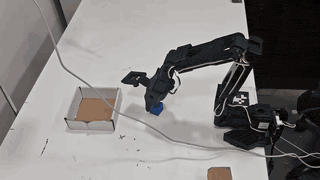
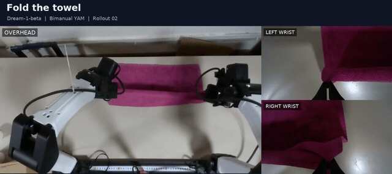

# Policies: setup, execution, and debugging

Karma captures robot observations, calls a policy, previews its predicted chunk,
and executes bounded absolute joint targets. The same client and scheduler power
`inference`, `rollout`, and `hitl`.

| Provider | Supported setup | Model runtime | Setup |
| --- | --- | --- | --- |
| MolmoAct2 | Bimanual YAM; SO101 with a calibrated policy frame | Remote GPU HTTP server | [MolmoAct2](molmoact2.md) |
| π0.5 | Bimanual YAM, `robocurve/pi0.5-yam` transforms | Remote OpenPI GPU server | [π0.5](pi05.md) |
| Dream | Bimanual YAM, joint outputs with optional pose assistance | Hosted API through an isolated SDK worker | [Dream](dream.md) |

## Rollout demos

| SO101 · MolmoAct2 | YAM · Dream |
| :---: | :---: |
| [](../media/so101-molmoact2-rollout.mp4) | [](../media/yam-dream-rollout.mp4) |
| [Full video · 22s](../media/so101-molmoact2-rollout.mp4) · [Setup](molmoact2.md) | [Full video · 2 min](../media/yam-dream-rollout.mp4) · [Setup](dream.md) |

Dream's recorded episode uses `dreamlabs/dream-1-beta` on bimanual YAM, with
3,593 frames captured over 120 seconds. See the [episode details](validation.md).

All maintained adapters live in this repository. Neither Spill nor Inspect Robots
is a runtime dependency. The untracked FlowDagger `_fd.py` variants retain their
own behavior and are outside this integration.

## Choose a profile

Copy a JSON file from `configs/policies/`, set its server address or checkpoint,
and pass it to any command. Resolution is built-in defaults, profile, then
explicit command-line overrides. Relative `worker_python` and `policy_frame`
paths in a profile resolve against the profile's directory.

```bash
# No motors or cameras are opened by this command.
uv run karma policy doctor --policy-config configs/policies/pi05-yam.json

uv run karma inference --rig yam_bimanual \
  --policy-config configs/policies/pi05-yam.json \
  --instruction "fold the towel" --speed 0.5

uv run karma rollout --rig yam_bimanual \
  --policy-config configs/policies/pi05-yam.json \
  --repo-id local/pi05-trials --episodes 3 --episode-seconds 120

uv run karma hitl --rig yam_bimanual \
  --policy-config configs/policies/pi05-yam.json \
  --repo-id local/pi05-corrections --episodes 3 --episode-seconds 120
```

Use the same commands with `molmoact2-yam.json` or `dream-yam.json`. Supply the
cell's existing `--interface`, `--camera-serial`, `--camera`, calibration, and
Quest connection flags as described in [YAM setup](../yam-setup.md) and
[HITL](../dagger.md). Examples above use the rig's configured devices; they do
not discover a remote GPU host automatically.

Existing `--server HOST --norm-tag TAG` MolmoAct commands still work. `--policy`
can explicitly select `molmoact2`, `pi05`, or `dream`; Dream requires a profile
with a checkpoint ID. Unknown profile fields fail early.

## Action rate versus control rate

`action_hz` describes the model's row rate. `--speed` scales that rate. Control
and recording can run at another frequency: a 20 Hz model at speed 0.5 consumes
10 action rows per second while a 30 Hz controller continues applying bounded
steps every tick. A model target is never a direct unbounded motor command.

Dream uses its SDK's adaptive refill decisions. HTTP policies estimate refill
lead from measured request latency. `--no-prefetch` waits until the chunk is
consumed, while inference still runs off the control thread. When the queue is
empty the previous safe command is held. Invalid predictions pause the policy;
Resume starts with fresh observations.

## Viser

With visualization enabled, open the printed Viser URL. Each provider has:

- Measured robot poses, predicted end-effector trails, grey endpoint ghosts,
  and a marker for progress through the active chunk.
- Live camera views and the latest encoded model-input views.
- Provider, instruction, chunk number, row count, action rate, pacing mode,
  and request latency.
- **Stop policy**: invalidate queued predictions and hold measured joints with
  the last commanded gripper openings.
- **Resume policy**: recheck feedback, reset model history, and infer again.
- **Home and stop**: cancel policy motion, follow Karma's existing guarded
  parking path, and de-energize. This terminates the run.

Prediction publication precedes command dispatch. Rendering runs independently,
so this is an automatic preview, not a browser acknowledgment or per-chunk
approval gate. Network/display latency can make the screen lag hardware.
Trails are model targets; clamps and feedback determine actual motion.

During HITL, the human retains ownership until the existing handback gesture.
Resume cannot take control away from an active intervention. Stop/resume does
not restart the episode clock. Recording continues during valid holds; session
logs distinguish control changes from the dataset's human-intervention labels.

`--no-viz` retains the same scheduler, validation, and hardware protections.
Use Ctrl+C for normal shutdown when running headless.

See [architecture](architecture.md) for extension points and
[debugging](debugging.md) for saved-observation probes and artifact locations.

Profiles declare `camera_roles` in model order. Real command runs require the rig's
configured cameras to match; declaring a role does not open or duplicate a camera.
Doctor uses the declared roles for metadata checks without opening capture devices.
For a SO101 profile, supply `--rig so101` to doctor/probe and configure the physical
`top` and `side` sources on execution commands.

Episodes start automatically. Before the first policy motion, a brief feedback
or camera gap waits for fresh observations without requiring Resume; queued
predictions from before the gap are discarded. Existing freshness limits and
the sustained-feedback timeout remain active. An operator Stop, provider error,
or freshness fault after policy motion begins still requires Resume. Dream
resets preserve the initialized SDK policy when its configuration is unchanged.
