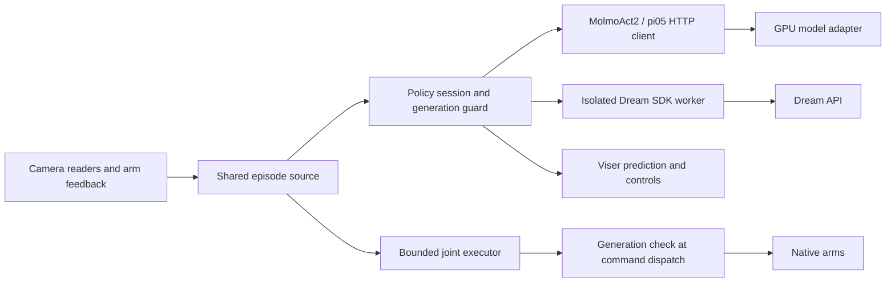

# Policy and serving architecture

## Ownership

`policies/config.py` validates reusable settings; `factory.py` selects the
provider. GPU imports only occur in `servers/`. Dream imports only occur in the
isolated worker. The robot process continues owning cameras, CAN, telemetry,
recording, and commands. Do not start Dream's station or another CAN driver.

`PolicySession` runs at most one inference at a time. A client-wide operation
lock also serializes resets across episode boundaries. The control loop polls
results without waiting for the worker. Each request captures a generation;
responses from an obsolete generation cannot become executable chunks.

`InferenceRolloutSource` shares execution between inference, rollout, and HITL.
The original programmatic mock/client path remains compatible. The legacy
MolmoAct reaching executor remains available for its explicit `--reach-actions`
workflow; it does not use the new policy panel. Use bounded execution (the
default) for the shared controls.

Viser callbacks change control intent only. Recording and continuous inference
recheck the generation while holding the control lock at dispatch. Human
intervention changes the same generation. Stale feedback inhibits commands;
resuming requires another observation and reset, never the old plan.

## Client contract

Managed clients expose `contract`, `config`, `display_name`, `action_hz`,
`health()`, `reset()`, `infer(observation, instruction)`, and `close()`.
`infer` returns a finite, nonempty N×D array of absolute targets in Karma's
canonical joint frame. Provider conversion happens at this boundary.
Optional `feed()` and `refill_due(executed, remaining)` support stateful policies.
Dream additionally receives the last commanded row for each arm as seam anchors.

The HTTP client retains `MolmoActClient` compatibility. A policy frame applies
once outbound and once inversely inbound; it never changes recorded state units
or native limits. Do not apply that conversion again on the server.

## HTTP contract version 1

`GET /act` reports `status`, `contract_version`, `provider`, `checkpoint`,
`norm_tag`, `state_dim`, `num_cameras`, `camera_roles`, `gripper_open`,
`joint_units`, `action_kind`, `action_hz`, and `image_encodings`.
The client validates identity and representation before opening hardware.
Legacy MolmoAct health metadata remains supported under its existing rules.
π0.5 requires the maintained adapter's provider metadata.

`POST /act` uses `json_numpy`, with `state`, `instruction`, `normalization_tag`,
and camera fields `top_cam`, `left_cam`, `right_cam`, or `side_cam`.
Images are RGB uint8 H×W×3 arrays or one-dimensional JPEG byte arrays.
The server serializes model inference, rejects incorrect normalization and state
widths, and validates outputs. Warmup must succeed before listening.

Responses contain `actions`, `inference_ms`, and `action_hz`. `dt_ms` remains
an alias of inference latency for old clients. It never means action period.
π0.5 fixes solver steps at load time and rejects a request that asks for another
value. MolmoAct2 forwards solver and CUDA-graph options to `predict_action`.

## Extending a provider

Implement the client contract, register it in the factory and profile validator,
and add a matching server adapter if needed. Add fake-model contract tests and
parameterized lifecycle tests before adding hardware examples. Stateful clients
must support reset between requests and reject late generations. A new provider
must not bypass the existing executor or take ownership of native interfaces.
