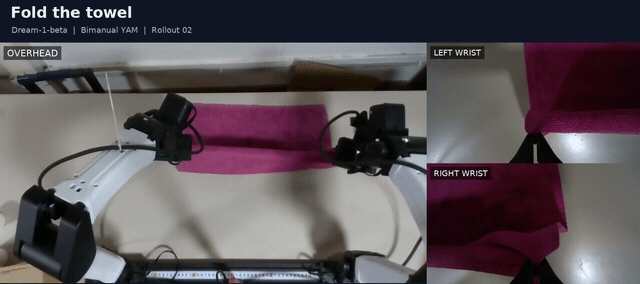

# Dream API on bimanual YAM

Karma uses the official Dream SDK against the hosted API. The worker only handles
observations and action predictions; Karma owns hardware. This follows the
[platform API setup](https://platform.dreamlabs.ai/docs/) and the installed SDK's
`DreamClient` documentation inspected on 2026-11-08. The platform's `/v1/meta`
currently links `/api-documentation`; direct documentation fetching returned its
application shell, so SDK source was used to verify lifecycle details.

## Towel-folding rollout

[](../media/yam-dream-rollout.mp4)

**[Watch the full rollout · 2 min](../media/yam-dream-rollout.mp4)**

`dreamlabs/dream-1-beta` on bimanual YAM, prompted to **“fold the towel.”**
The collage combines the overhead and both wrist cameras with the task prompt.
The looping preview plays at 1.5× speed; the full recording plays at recorded speed.

The API health check, prediction probe, and physical recorded rollout completed
on 2026-11-08. Karma saved 3,593 frames over 120 seconds, and the operator marked
the episode successful. See [episode details and artifacts](validation.md).

## Install and authenticate

From Karma's checkout:

```bash
uv sync --locked --project runtime/dream
export DREAM_API_KEY='YOUR_KEY'
uv run karma policy doctor --policy-config configs/policies/dream-yam.json
```

The isolated runtime pins `dreamlabs==1.0.23` and `dreamlabs-client==1.0.14` on
Python 3.12. It avoids the full SDK's dependency conflicts with LeRobot. An
installed Karma package outside this checkout needs `worker_python` set to the
absolute path of this runtime's Python interpreter.

Credentials can instead use the SDK's `~/.dreamlabs/credentials` file. Endpoint
variables are `DREAM_GATEWAY_URL=https://api.dreamlabs.ai`,
`DREAM_API_URL=https://platform.dreamlabs.ai`, and
`DREAM_DATA_URL=https://data.dreamlabs.ai`. Keys are inherited through the
environment/SDK credential mechanism; they are not profile fields or CLI flags.
Do not commit credentials.

The example explicitly selects `dreamlabs/dream-1`. Use a checkpoint listed for
your account; doctor verifies availability and servability. Karma never swaps
`dream-1` and `dream-1-beta`. An accessible model is not evidence of physical task
success on this cell.

## Embodiment and observations

The supported layout is bimanual YAM with six joint radians and one normalized
gripper per arm, 1=open. Dream embodiment vectors are right-first; Karma vectors
are left-first. Named `q_l_chunk`/`q_r_chunk` outputs are joined explicitly.

| Karma | Dream |
| --- | --- |
| `top` | `video.overhead` |
| `left_wrist` | `video.wrist_l` |
| `right_wrist` | `video.wrist_r` |
| Left joints/gripper | `state.left_arm`, `state.left_gripper` |
| Right joints/gripper | `state.right_arm`, `state.right_gripper` |

Images are resized to 320×176 and encoded as base64 JPEG strings, matching the
Spill integration. The SDK retains nine frames per camera sampled at 5 Hz and
the latest state. Observation feeding continues during network inference, with
bounded buffering; overflow drops old ticks and emits a diagnostic event.

`dream-yam.json` enables `ik={"arm":"yam","head":"joint"}` to supply pose
information while retaining joint actions. `dream-yam-joint-only.json` disables
pose assistance and is appropriate only for checkpoints that accept joint-only
observations. Unsupported rigs and camera layouts fail before hardware starts.

## Lifecycle and pacing

Each episode starts a fresh session. Ordinary chunks retain model memory.
Stop, HITL handoff, and resume invalidate queued results; resumption resets the
SDK between requests. The SDK cannot reset while an inference is active, so the
control loop holds independently while that request finishes or times out.

The default is 20 action rows/s and execution horizon 30. The SDK chooses
asynchronous refill or synchronous whole-chunk pacing from measured latency.
Karma supplies its effective action rate after `--speed`, and uses SDK refill
results without network work on the control thread. `pacing: "sync"` explicitly
selects synchronous chunks. `--no-prefetch` also waits for queue exhaustion.

SDK errors pause policy execution and appear in the panel and worker logs.
Authentication/configuration failures are not automatically retried. Resume
requests a fresh prediction; an exited worker requires restarting the command.

## Run

```bash
uv run karma inference --rig yam_bimanual \
  --policy-config configs/policies/dream-yam.json \
  --instruction "fold the towel" --speed 0.5
uv run karma rollout --rig yam_bimanual \
  --policy-config configs/policies/dream-yam.json --repo-id local/dream-rollouts
uv run karma hitl --rig yam_bimanual \
  --policy-config configs/policies/dream-yam.json --repo-id local/dream-hitl
```

Add your cell's device and Quest flags. Viser's Stop policy, Resume policy, and
Home and stop use the same execution controls as the other providers.

The isolated worker has one small version-pinned SDK hook: it observes the
window's `build_observation()` boundary so a subsequent camera tick cannot
replace the request snapshot before `get_action()` captures it. Tick feeding then
continues during network inference. Re-run `tests/test_dream_bridge.py` when
upgrading the SDK; the worker deliberately fails if that boundary changes.
