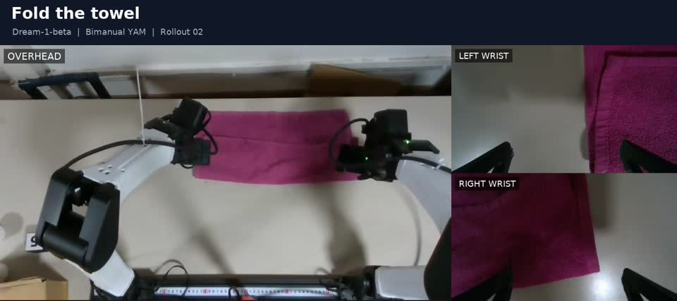

# Dream rollout record

Recorded on 2026-11-08 with `dreamlabs/dream-1-beta` on bimanual YAM.

**[Watch the full rollout · 2 min](../media/yam-dream-rollout.mp4)**

## Episode summary

- Isolated SDK runtime installed; doctor returned `health.status: ok` for
  `dreamlabs/dream-1-beta`.
- A synthetic-observation probe returned numeric action chunks without opening
  motors. This verified API prediction, not camera mapping or task performance.
- Physical `karma rollout` ran on `yam_bimanual` with top, left-wrist, and
  right-wrist cameras, prompt **"fold the towel"**, `--speed 1`, one episode,
  and `--episode-seconds 120`.
- Startup waited for fresh feedback and began policy execution automatically
  once observations were available. No initial Resume press was required.
- Viser connected on port 8080 during the rollout.
- The episode saved 3,593 frames. Both arms parked at `home_pos` and
  de-energized on normal completion. The operator answered `y` to episode success.
- A camera collage MP4 was generated and stored locally with the task prompt,
  overhead view, and both wrist views.

The documentation video is included in `docs/media/`. Dataset and runtime
artifacts remain local:

| Artifact | Location |
| --- | --- |
| Dataset ID | `local/dream-towel-rollout-02` |
| Dataset directory | `~/.cache/huggingface/lerobot/local/dream-towel-rollout-02` |
| Policy run | `logs/runtime/policies/20261108T231202-7d8ac732/` |
| Published video | `docs/media/yam-dream-rollout.mp4` |
| Original collage | `outputs/rollout-collages/dream-towel-rollout-02-collage.mp4` |
| Local profile | `configs/policies/dream-yam.local.json` |

The tested local profile selects `dreamlabs/dream-1-beta`; the checked-in example
selects `dreamlabs/dream-1`. These are separate checkpoints. Raw prediction payload
capture was disabled for this run: response metadata and recorded executed actions
are available, but the complete returned chunks were not saved. The camera collage
does not display raw Dream predictions.
