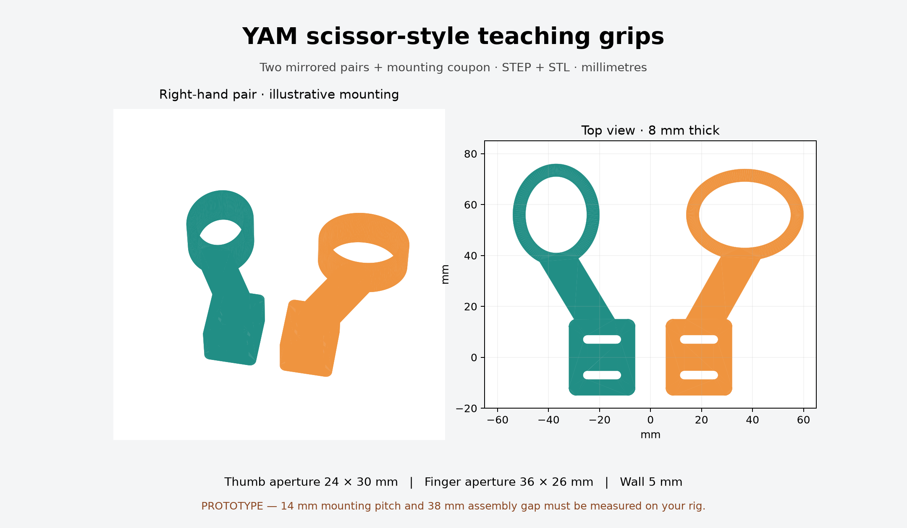

# YAM scissor-style teaching grips

**Use the [V2 Flash-style leads](v2/README.md)** for the jaw-mounted short thumb
saddle, long finger lead, adjustable straps and removable split clamps. V2 includes
mounted open/closed renders, both hand variants, STEP/STL exports and a clearance report.

The original flat-loop prototype below is retained for comparison.

## Original flat-loop prototype



Editable CAD and printable parts for direct hand-guided gripper operation, inspired
by the [Flash-ALOHA hardware tutorial](https://johnyao93.github.io/flash-aloha/).
These are two independent finger loops attached to the moving jaws; the existing
linear gripper supplies the motion. There is no cutting blade or central hinge.
This is newly drawn parametric geometry, not a verified factory YAM adapter.

## Files

- `generated/assembly.step`: illustrative right-hand pair, separately selectable parts.
- `generated/{right,left}_{thumb,finger}_grip.{step,stl}`: four parts for two hands.
- `generated/fit_coupon.{step,stl}`: mounting plate only; print this first.
- `parameters.json`, `build.py`: editable dimensions and CadQuery source, in mm.
- `generated/manifest.json`: solid count, volume and envelope per part.

Every exported part was checked as one valid CAD solid and one connected,
watertight STL with consistent winding. Those checks establish export integrity,
not mounting fit, hand ergonomics, load capacity or collision clearance on a YAM.

## Measure before the full print

The **14 mm mounting pitch**, **3.4 mm slots** and **38 mm closed assembly gap**
are explicit prototype assumptions. The slots are 15 mm long horizontally; they
cannot compensate for an incorrect vertical hole pitch. Measure your jaw's
fastener type, hole direction, pitch, available flat mounting area and fastener
engagement depth. Change the plate/slot parameters or design an adapter if those
features differ. Do not drill into the gripper using these assumed dimensions.

Print the coupon flat at 100% scale and check it on the unpowered jaw. Hardware
length and thread are deliberately unspecified until the actual jaw is measured.
Check the loops against camera mounts, table, cables and the opposing arm over
all intended poses and jaw travel. `reference_total_jaw_travel=95` comes from
the upstream i2rt linear_4310 model (two 47.5 mm slides); it is reference travel,
not proof that the loops can be operated through that full range by one hand.

Default dimensions: 8 mm thickness, 5 mm ring wall, 24 × 30 mm thumb aperture,
36 × 26 mm finger aperture, 26 × 30 mm mounting plate. The left parts mirror the
right parts. Select hand/arm placement to keep the loops outboard. The assembly
preview contains no robot body and makes no clearance claim.

Start with a coupon, then an unloaded grip prototype. Print flat with the ring
plane on the bed; no supports are needed for this geometry. Use a tough material
appropriate to your printer, inspect layer adhesion, and ease all skin-contact
edges. Select print strength after a bench load check; no structural analysis or
physical testing has been performed. Verify fingers can leave the loops easily.
Weigh the fitted parts and fasteners and update the gravity payload before
calibrating teaching assistance. Manifest mass estimates assume solid PETG at
1.27 g/cm³ and exclude fasteners and print voids.

## Regenerate

```bash
uv venv .venv-cad
uv pip install --python .venv-cad/bin/python -r hardware/scissor/requirements.txt
.venv-cad/bin/python hardware/scissor/build.py
.venv-cad/bin/python hardware/scissor/preview.py
```

Edit `parameters.json` first. Recheck the new coupon after changing mount dimensions.
