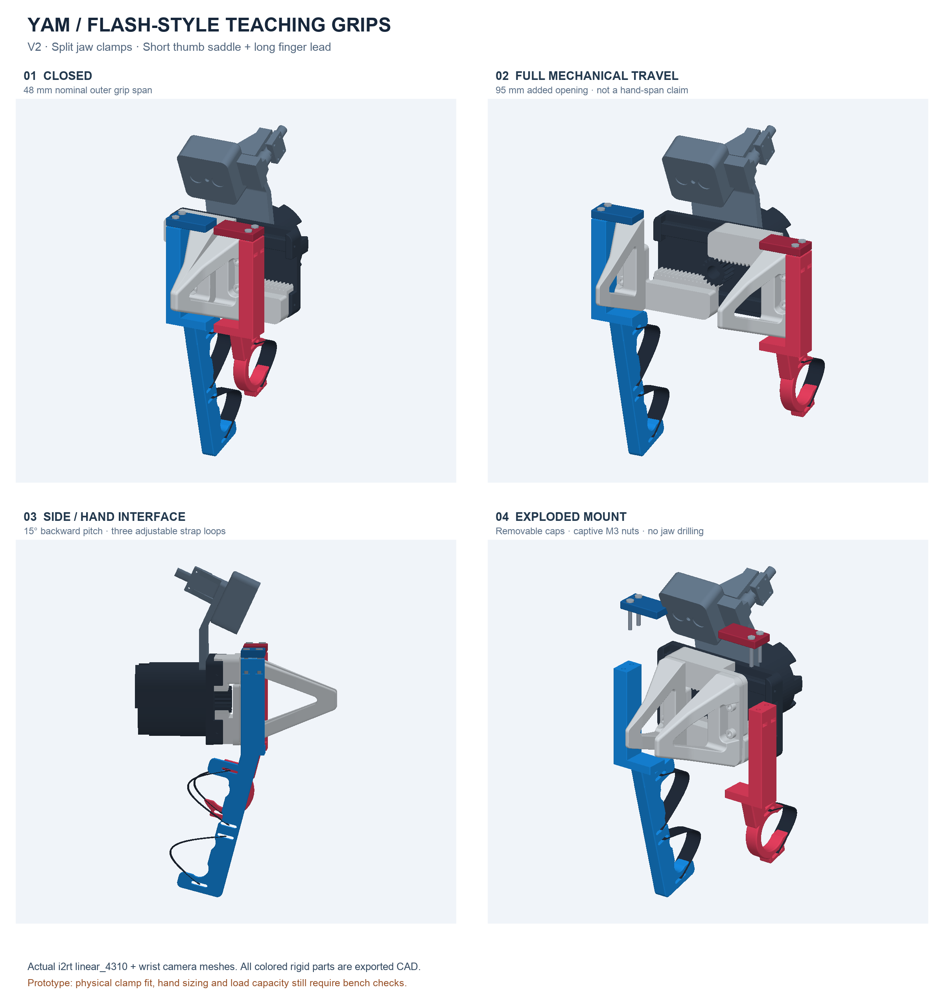

# YAM Flash-style teaching leads — V2



This revision follows the short thumb lead, long finger lead and three-strap
layout in the [Flash ALOHA hardware tutorial](https://docs.google.com/document/d/1GAxYQq6ppRNMVVDRZRWVP7z5HXIXlONxjdPNFYmqPC0/edit).
It adapts that hand interface to the **YAM linear_4310** with removable split
clamps around the existing moving jaw roots. The tutorial's M3 mounting-hole
pattern belongs to its reference hardware and is **not** assumed to fit YAM.
The original YAM fingertips and camera mount stay in place.

This is finished, editable **prototype CAD**, not a physically qualified adapter.
The actual jaw, printed clamp friction, fastener seating and hand size must be
checked before powered use. The reference screenshots were used for design
intent; this package does not contain Claude/Gemini's underlying CAD.

## What is included

- `generated/right_hand_assembly.step`: colored, separately selectable thumb
  lead, finger lead, caps and schematic straps. Gripper/camera are not STEP solids.
- `generated/left_hand_assembly.step`: opposite-hand rigid assembly.
- `generated/{right,left}_{thumb,finger}_lead.{step,stl}`: integrated handle and
  lower clamp, four handed parts for the bimanual rig.
- `generated/{negative,positive}_jaw_cap.{step,stl}`: removable upper caps.
- `generated/fit_coupon_base.{step,stl}`: same clamp without the handle. Pair with
  `negative_jaw_cap` for the initial unpowered fit check.
- `generated/yam_{closed,open}.glb`: complete visual assemblies with actual YAM
  and wrist-camera meshes, in metres. These are viewing models, not print plates.
- `generated/reference_*.stl`: flexible strap illustrations only; **do not print**.
- `generated/overview.png`, `hero.png`: renders produced directly from the models.
- `generated/manifest.json`: CAD solid validity, volumes and envelopes.
- `generated/clearance_report.json`: STL integrity and sampled rigid mesh checks.
- `build.py`, `inspect_assembly.py`, `parameters.json`: reproducible sources.

Assembly coordinates in STEP/STL are **millimetres**: X is jaw travel, Y points
toward the fingertips, Z is up. Parts retain their assembly coordinates; orient
and arrange them explicitly in the slicer. `right` and `left` indicate opposite
hand interfaces, not a prescribed robot bus assignment.

## Design and dimensions

| Feature | Nominal CAD value |
| --- | --- |
| Jaw-root clamp band | Y = 72–90 mm in assembly coordinates |
| Clamp cavity height before compression | 69.2 mm |
| Outer wall / lower ledge | 12 mm / 6 mm |
| Cap thickness | 6 mm |
| Cap-to-wall closing gap | 1 mm |
| Fasteners per jaw clamp | 2 × M3 socket screws + captive nuts |
| Screw clearances / nut pocket across flats | 3.4 mm / 5.8 mm |
| Grip plate thickness | 10 mm |
| Thumb saddle inner diameter | 28 mm |
| Handle backward pitch | 15° |
| Strap slots / nominal strap width | 13 × 2.6 mm / 12 mm |
| Outer grip-face span at zero slide position | 48 mm |
| Visual model slide range | 0–47.5 mm per jaw |
| Outer grip-face span at full slide range | 143 mm |

The 95 mm total mechanical travel is **not an ergonomic operating-range claim**.
Choose a comfortable opening range after the fit check. The C-shaped thumb
saddle and open finger paddle allow release by loosening the straps; straps should
remain adjustable rather than cinching the hand tightly to the robot.

The clamp is retained by compression and friction. It is not a positively keyed
factory mount. Its upper cap can move down by 1 mm before meeting the lower
wall. The jaw root tapers forward, so use small compliant contact strips near
the rear of the clamp rather than pretending the entire cap is a flat mating
surface. Physical fit may require changing the cavity height or pad thickness.

## Hardware and assembly

For **one gripper** (double these quantities for the bimanual rig):

| Item | Quantity | Notes |
| --- | ---: | --- |
| Thumb lead and finger lead | 1 each | Select a matched right- or left-hand set |
| Negative and positive jaw caps | 1 each | Their X sign identifies their side |
| M3 × 20 socket-head screws | 4 | CAD uses 5.5 mm head envelope; verify actual head and engagement |
| M3 hex nuts | 4 | Side-loading 5.8 mm AF × 2.8 mm pockets |
| 12 mm hook-and-loop straps | 3 | One thumb loop; two finger loops; cut to the hand |
| Compliant adhesive liner, about 1 mm thick | 4 strips | Start at 12 × 3 mm; one top and bottom per jaw |

1. Print the coupon and one cap first. With the robot unpowered, check the
   jaw-root cross-section at Y = 72–75 mm and the cap's removal path. The clamp
   must sit on the moving finger root, clear of the rack/rail and stock screws.
2. Place the compliant strips on the inward-facing cap and bottom ledge near
   Y = 72.5–75.5 mm, X magnitude approximately 6–18 mm. The strips accommodate
   the mesh-derived clearance and distribute pressure. They are consumable
   material, not rigid printable geometry.
3. Seat the four nuts in the side-access pockets. Place each lead's lower ledge
   under its jaw root and install its matching cap from above. Tighten the two
   screws evenly until the jaw is held; verify the cap retains adjustment room.
   Do not use bottoming-out as the torque target. No torque specification or
   clamp load has been validated.
4. Confirm the screws engage the nuts without touching the jaw. The render's
   screws are unthreaded size envelopes; the supplied STL parts contain the
   clearance holes, head recesses and nut pockets.
5. Thread one strap through the thumb saddle's two slots, and two straps through
   the long lead's upper/lower slot pairs. The ribbon shapes in STEP/GLB illustrate
   the loops; actual threading includes a return around the slots and a hook-and-
   loop overlap, which are not modeled.
6. Check slip under unloaded manual pushing/pulling, hand release, the jaw travel,
   wrist camera/cables, table and opposite arm. Weigh the complete fitted hardware
   and update the payload used by gravity compensation before teaching.

Print the leads with their broad handle faces supported and inspect the clamp
ledges, strap-slot bridges and nut pockets in the slicer. Unlike the old flat
loops, these clamps can need supports depending on orientation. Use a material
and print setup suitable for a hand-loaded prototype. The tutorial's 50% infill
is a starting reference, not a strength qualification for this geometry. Ease
any rough skin-contact edges and test the coupon before printing both sets.

## What the checks establish

The exported parts are single valid CAD solids. The build removes only duplicate
and zero-area triangles created at fillet poles by binary STL export, then
requires connected, consistently wound, watertight meshes. No hole filling or
free-form shape repair is used.

The clearance script checks both hand variants against the actual gripper body,
both jaws, the station's wrist camera assembly and each other through the 47.5 mm per-jaw range. It first prunes triangle
pairs using conservative bounds enclosing their entire linear travel. Any
unresolved pair is checked for surface intersections on a grid no coarser than
0.5 mm per jaw. In this build, all 44 pair checks across both hand variants
were resolved by disjoint swept bounds; no fine-grid VTK queries were needed.
Separate overlap, crossing-motion and separation controls exercise the checker.
This is not a minimum-clearance certificate or a physical collision test. Flexible straps,
compressible liners, fasteners, hands, cables and the surrounding robot scene
are excluded. Inspect the report for the result; mesh checks do not establish
physical fit, collision-free operation in the real scene, or strength.

## Regenerate

```bash
uv venv --python 3.12 .venv-cad
uv pip install --python .venv-cad/bin/python -r hardware/scissor/v2/requirements.txt
.venv-cad/bin/python hardware/scissor/v2/build.py
.venv-cad/bin/python hardware/scissor/v2/inspect_assembly.py --i2rt /path/to/i2rt
```

`inspect_assembly.py` expects the reference i2rt checkout at commit
`61b1ebda80d0b3839843bb06fadf42b6b83bd3c4`. It uses the standalone
`linear_4310.xml` jaw transforms and registers the station camera through the
shared gripper mesh transform. The station model's separate jaw assembly is not
substituted for the standalone gripper.

Edit dimensions in `parameters.json`, regenerate and repeat the coupon check.
The hand profile lengths and finger scallops are editable in `build.py`.
The build and inspection scripts are development tools, not robot runtime code.

Reference YAM/camera meshes are from [I2RT](https://github.com/i2rt-robotics/i2rt),
MIT licensed; see `I2RT-LICENSE.txt`. GLB and PNG outputs include those meshes.
